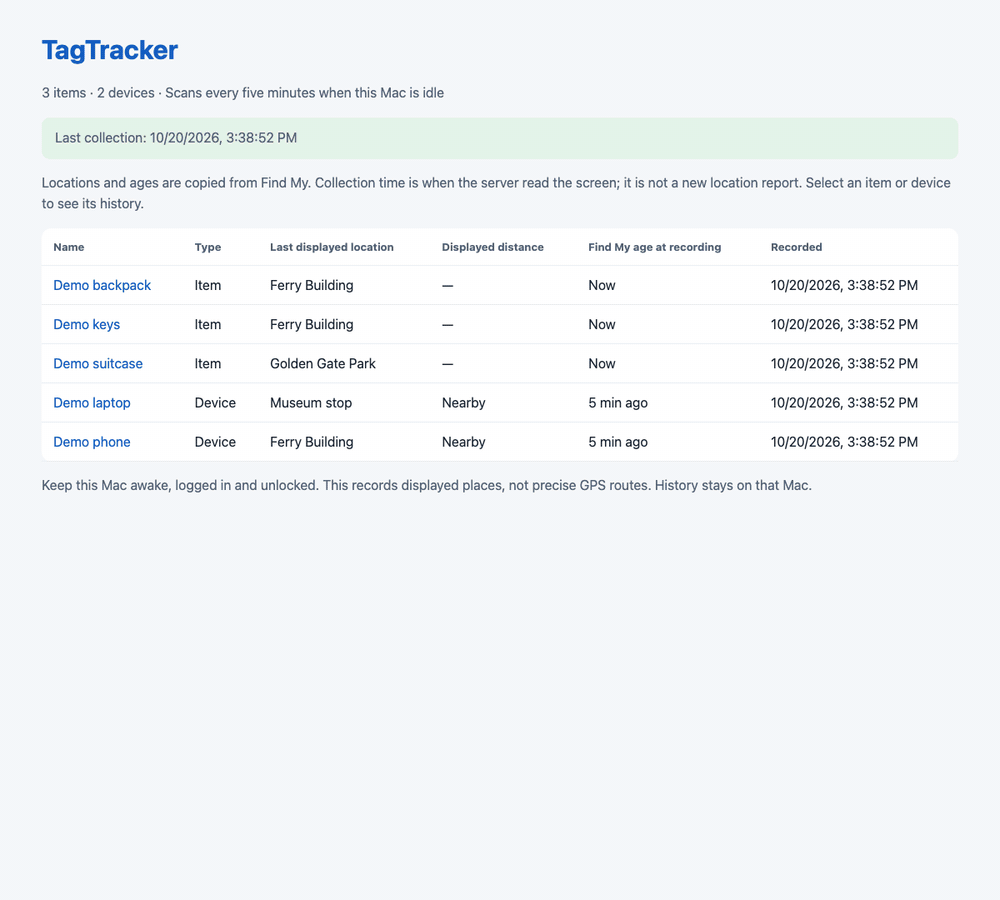

# TagTracker

Local location history for your AirTag items on macOS. TagTracker reads the places displayed in Find My, saves observations in SQLite, and shows them on a local map with date filters.

**Experimental source release.** This is currently a command-line collector and browser dashboard, not a packaged or notarized Mac app. A native setup interface and the orange pin-over-stacked-maps icon are planned.

## Screenshots and demo

[Project website](https://danielyaa5.github.io/tagtracker/) · [Animated demo](site/assets/demo.gif)

All screenshots and the demo use fictional items and observations at public landmarks.



| Items overview | Location history |
| --- | --- |
| [](site/assets/overview.png) | [](site/assets/history.png) |

## Features

- History for selected Find My items, stored on your Mac.
- Map filters for 24 hours, one week, one month, three months, all time, and custom dates.
- Automatic map fitting and user-configured coordinates for labels such as Home.
- Five-minute scans after two minutes without keyboard or mouse input.
- Scans pause while macOS Screen Sharing is connected, and stop when input resumes.
- Find My window cleanup after success, failure, or interruption.
- Collection status and diagnostic logs to explain gaps.

## What the data means

An observation records **what Find My displayed when the scan ran**. It is not a fresh GPS fix. The same old location may appear in many observations. Saved places use your supplied coordinates; the optional GeoNames lookup uses approximate town centers. Lines between pins are not measured routes. Unknown places remain unplotted.

The collector needs an awake, logged-in, unlocked Mac. It opens and controls Find My when scanning; it is not invisible background collection. macOS changes, text-recognition failures, permissions, and user activity can cause gaps. Screen Sharing detection covers macOS Screen Sharing connections, not every third-party remote-control app.

## Build and setup

Requirements: macOS, Xcode Command Line Tools (`xcode-select --install`), Go 1.22 or newer, and Python 3.9 or newer. The adapters and LaunchAgents use `/usr/bin/python3`; verify it is available. The deployed collector has been exercised on macOS 27; other versions have not been validated.

```sh
git clone https://github.com/danielyaa5/tagtracker.git
cd tagtracker
make build
python3 scripts/setup.py --item 'Keys' --item 'Backpack'
```

Use the exact item names visible in Find My, including case. The setup command writes private configuration and three LaunchAgents but does not start them unless `--load` is added. Configure item aliases in `~/Library/Application Support/TagTracker/item-names.json` if OCR consistently misspells a name. The collector accepts only configured names to avoid recording interface labels as items.

In System Settings → Privacy & Security, grant **Accessibility** and **Screen & System Audio Recording** (or **Screen Recording**, depending on macOS) to the built `bin/findmy` collector as requested by macOS. Permission attribution can differ between macOS versions; use the helper's `permissions` command for diagnostics. Rebuilding binaries can invalidate permission grants. Do not disable SIP.

After configuring permissions, load the generated agents:

```sh
launchctl bootstrap gui/$(id -u) "$HOME/Library/LaunchAgents/io.tagtracker.sharing-probe.plist"
launchctl bootstrap gui/$(id -u) "$HOME/Library/LaunchAgents/io.tagtracker.history.plist"
launchctl bootstrap gui/$(id -u) "$HOME/Library/LaunchAgents/io.tagtracker.collector.plist"
```

Open **http://127.0.0.1:8768/**. Disconnect Screen Sharing and leave the Mac idle to permit collection. The scheduler checks every minute, but successful scans are spaced about five minutes apart. Confirm a new observation and `window-close-status.json` after the first scan.

The checkout must stay at the same path while its agents are installed. Port 8768 must be free. Do not run alongside another Find My automation collector. The setup does not import or alter another installation's data.

## Map configuration

Create `~/Library/Application Support/TagTracker/saved-places.json` with labels matching Find My:

```json
{
  "Example place": {
    "lat": 0.0,
    "lon": 0.0,
    "precision": "User configured"
  }
}
```

Replace the example with your own label and coordinates. Keep this file private. For optional approximate town lookup, run `python3 scripts/build_places.py`; it downloads public GeoNames data and creates a local gazetteer. Without it, saved places still work and other labels remain unplotted.

## Privacy

No Apple-account credentials or AirTag keys are requested. Collection uses the Find My app already signed in on your Mac. Configuration, history, screenshots used for diagnostics, and logs stay in `~/Library/Application Support/TagTracker/` (override with `TAGTRACKER_DATA_DIR`). Diagnostic OCR text can contain private locations. Do not upload these files in bug reports.

The dashboard binds to loopback only and has no login system. Do not expose it directly to the internet. Map tiles are fetched from OpenStreetMap; the tile provider can see your IP and requested map areas. The optional gazetteer download contacts GeoNames. No personal location history or account credentials are included in this repository.

## Stop or uninstall

```sh
launchctl bootout gui/$(id -u)/io.tagtracker.collector
launchctl bootout gui/$(id -u)/io.tagtracker.history
launchctl bootout gui/$(id -u)/io.tagtracker.sharing-probe
```

Remove the three `io.tagtracker.*.plist` files from `~/Library/LaunchAgents` to prevent automatic startup. Your history is retained. Delete the TagTracker Application Support folder only if you also want to erase your data.

## Development

`make test` runs Go tests, scan lifecycle tests, and portable setup/map tests. See [CONTRIBUTING.md](CONTRIBUTING.md). Build and simulated-data checks do not establish live Find My compatibility on every Mac; verify the real permission, collection, database, and window-cleanup flow before distributing binaries.

## Recreate the demo media

`python3 scripts/demo_server.py` serves the real dashboard at http://127.0.0.1:8769/ using a temporary sample database. It does not read your configuration or open Find My. Stop it with Control-C to remove the sample data.

To regenerate the screenshots and animated GIF, install Node.js, Playwright with Chromium, and ffmpeg, then run `node scripts/capture_demo.cjs`. Set `PLAYWRIGHT_CHROMIUM_EXECUTABLE` to use an existing Chrome/Chromium binary if needed. Capture runs headlessly and closes its browser and demo server afterward. The static website lives in `site/` and deploys through GitHub Pages on pushes to `main`.

## Credits and license

MIT license. Built from [Omar Shahine's findmy-cli](https://github.com/omarshahine/findmy-cli), source snapshot `8ee4b99`. The upstream Go module path is retained for compatibility. See [LICENSE](LICENSE) and [THIRD_PARTY_NOTICES.md](THIRD_PARTY_NOTICES.md).

AirTag is a trademark of Apple Inc. TagTracker is independent and is not affiliated with or endorsed by Apple.
