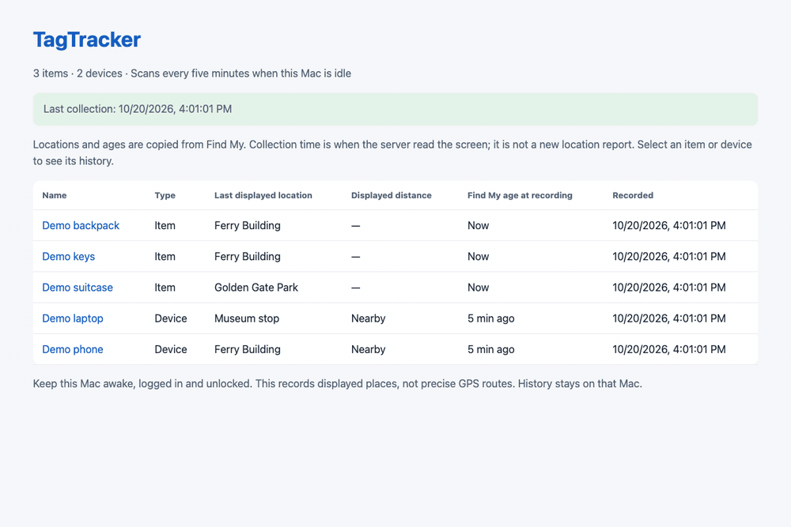
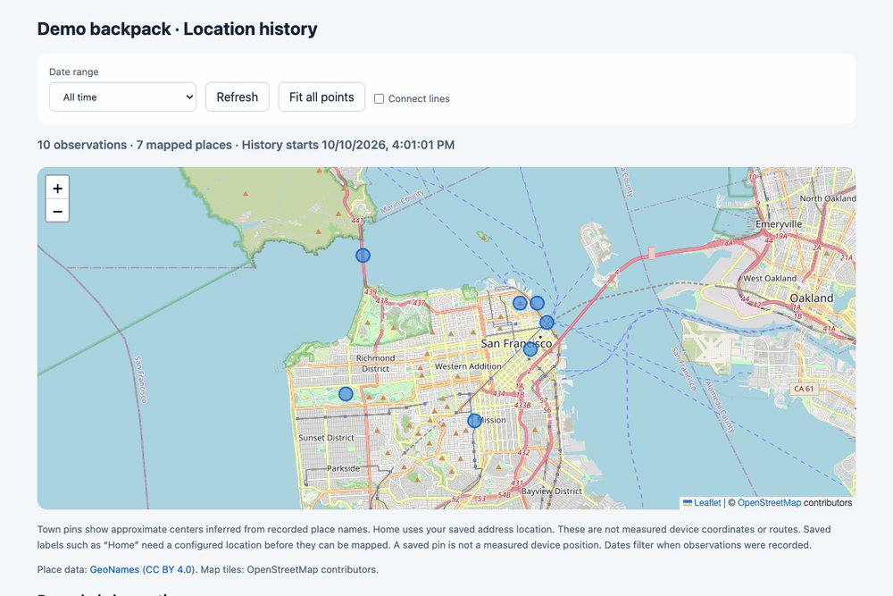
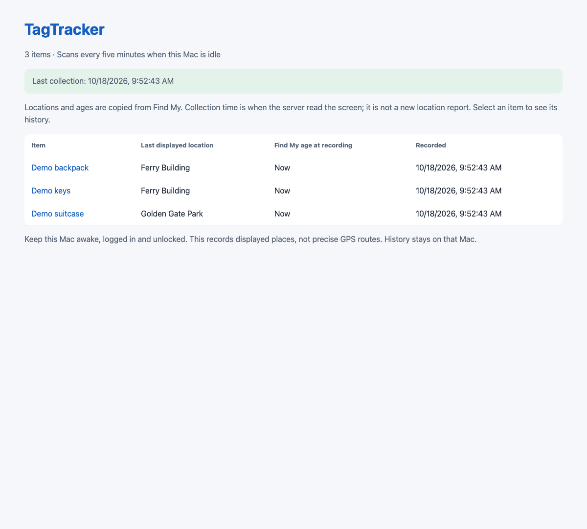
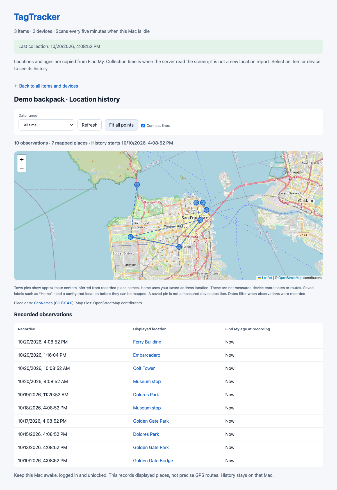
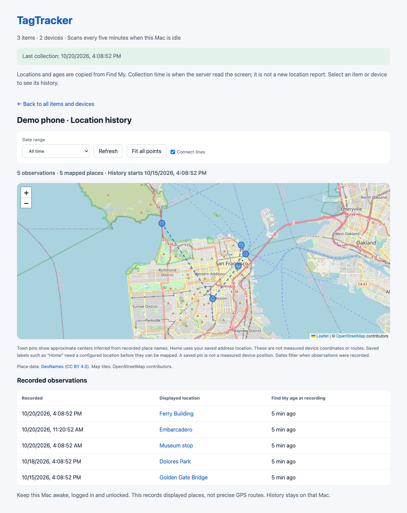

# TagTracker

Local location history for Find My items and devices on macOS. TagTracker reads the places displayed in Find My, saves observations in SQLite, and shows them on a local map with date filters.

[](https://github.com/danielyaa5/tagtracker/releases/latest/download/TagTracker.dmg)

**Experimental Mac app.** Apple silicon, macOS 14 or later. The DMG includes the native setup app, collector, and Python runtime. Drag **TagTracker** into **Applications**, then open it there. It ejects its matching installer disk automatically. Use **Start Tracking** to choose your items and configure the local services; grant the requested macOS permissions. **Open History** opens the dashboard in your browser.

Sparkle checks for signed updates, and **TagTracker → Check for Updates…** lets you check manually. Update installation requires your choice. The command-line collector remains available for source builds.

## Screenshots and demo

[Project website](https://danielyaa5.github.io/tagtracker/) · [View the demos](https://danielyaa5.github.io/tagtracker/#demo)

All screenshots and the demo use fictional items, devices, and observations at public landmarks.

**Browse history.** Select an item, then switch between the last day, week, and all time.



**Explore the map.** Connect timeline points, open a pin, and fit all displayed places.



| Items and devices | Location history | Device history |
| --- | --- | --- |
| [](site/assets/overview.png) | [](site/assets/history.png) | [](site/assets/devices.png) |

## Features

- History for selected Find My items, stored on your Mac.
- Optional Devices collection in the same scan, including displayed location, age, distance and battery when visible. Enable with `--devices` during setup or `"collect_devices": true` in the private item configuration. Device and item histories remain separate even when their names match.
- Map filters for 24 hours, one week, one month, three months, all time, and custom dates.
- Automatic map fitting and user-configured coordinates for labels such as Home.
- Five-minute scans after two minutes without keyboard or mouse input.
- Scans pause while macOS Screen Sharing is connected, and stop when input resumes.
- Find My window cleanup after success, failure, or interruption.
- Collection status and diagnostic logs to explain gaps.

## What the data means

An observation records **what Find My displayed when the scan ran**. It is not a fresh GPS fix. The same old location may appear in many observations. Saved places use your supplied coordinates; the optional GeoNames lookup uses approximate town centers. Lines between pins are not measured routes. Unknown places remain unplotted.

The collector needs an awake, logged-in, unlocked Mac. It opens and controls Find My when scanning; it is not invisible background collection. macOS changes, text-recognition failures, permissions, and user activity can cause gaps. Screen Sharing detection covers macOS Screen Sharing connections, not every third-party remote-control app.

## Build and setup

Source-build requirements: macOS, Xcode Command Line Tools (`xcode-select --install`), Go 1.22 or newer, and Python 3.9 or newer. The adapters use Python from the configured service PATH. The packaged app supplies its own interpreter. The deployed collector has been exercised on macOS 27; live Find My collection on other versions has not been validated.

```sh
git clone https://github.com/danielyaa5/tagtracker.git
cd tagtracker
make build
python3 scripts/setup.py --item 'Keys' --item 'Backpack'
```

Use the exact item names visible in Find My, including case. The setup command writes private configuration and three LaunchAgents but does not start them unless `--load` is added. Configure item aliases in `~/Library/Application Support/TagTracker/item-names.json` if OCR consistently misspells a name. The collector accepts only configured names to avoid recording interface labels as items. Devices are discovered by paging the Devices sidebar. Optional `device_aliases` map verified OCR misspellings to a canonical device name; `expected_devices` lists devices that must be read before a sweep is considered complete. Numeric distances and Nearby readings are checked in two separate captures. Original OCR spellings are retained in private record metadata when an alias is used.

In System Settings → Privacy & Security, grant **Accessibility** and **Screen & System Audio Recording** (or **Screen Recording**, depending on macOS) to the built `bin/findmy` collector as requested by macOS. Permission attribution can differ between macOS versions; use the helper's `permissions` command for diagnostics. Rebuilding binaries can invalidate permission grants. Do not disable SIP.

After configuring permissions, load the generated agents:

```sh
launchctl bootstrap gui/$(id -u) "$HOME/Library/LaunchAgents/io.tagtracker.sharing-probe.plist"
launchctl bootstrap gui/$(id -u) "$HOME/Library/LaunchAgents/io.tagtracker.history.plist"
launchctl bootstrap gui/$(id -u) "$HOME/Library/LaunchAgents/io.tagtracker.collector.plist"
```

Open **http://127.0.0.1:8768/**. Disconnect Screen Sharing and leave the Mac idle to permit collection. The scheduler checks every minute, but successful scans are spaced about five minutes apart. Confirm a new observation and `window-close-status.json` after the first scan.

Scheduled polls report a normal wait when idle gating, scan spacing or Screen Sharing intentionally pauses collection. Real capture and collection errors still return a failure. The scheduler wrapper requires an explicit acknowledgement from the current collector invocation; a previous scan state cannot turn an unrelated failure into success.

The checkout must stay at the same path while its agents are installed. Port 8768 must be free. Do not run alongside another Find My automation collector. The setup does not import or alter another installation's data.

## Map configuration

Create `~/Library/Application Support/TagTracker/saved-places.json` with labels matching Find My:

```json
{
  "Example place": {
    "lat": 0.0,
    "lon": 0.0,
    "precision": "User configured"
  }
}
```

Replace the example with your own label and coordinates. Keep this file private. For optional approximate town lookup, run `python3 scripts/build_places.py`; it downloads public GeoNames data and creates a local gazetteer. Without it, saved places still work and other labels remain unplotted.

## Privacy

No Apple-account credentials or AirTag keys are requested. Collection uses the Find My app already signed in on your Mac. Configuration, history, screenshots used for diagnostics, and logs stay in `~/Library/Application Support/TagTracker/` (override with `TAGTRACKER_DATA_DIR`). Diagnostic OCR text can contain private locations. Do not upload these files in bug reports.

The dashboard binds to loopback only and has no login system. Do not expose it directly to the internet. Map tiles are fetched from OpenStreetMap; the tile provider can see your IP and requested map areas. The optional gazetteer download contacts GeoNames. The Mac app checks GitHub Pages for updates and downloads signed archives from GitHub Releases. Sparkle system-profile reporting is disabled. No personal location history or account credentials are included in this repository.

## Stop or uninstall

```sh
launchctl bootout gui/$(id -u)/io.tagtracker.collector
launchctl bootout gui/$(id -u)/io.tagtracker.history
launchctl bootout gui/$(id -u)/io.tagtracker.sharing-probe
```

Remove the three `io.tagtracker.*.plist` files from `~/Library/LaunchAgents` to prevent automatic startup. Your history is retained. Delete the TagTracker Application Support folder only if you also want to erase your data.

## Development

`make test` runs Go tests, scan lifecycle tests, and portable setup/map tests. See [CONTRIBUTING.md](CONTRIBUTING.md). Build and simulated-data checks do not establish live Find My compatibility on every Mac; verify the real permission, collection, database, and window-cleanup flow before distributing binaries.

## Recreate the demo media

`python3 scripts/demo_server.py` serves the real dashboard at http://127.0.0.1:8769/ using a temporary sample database. It does not read your configuration or open Find My. Stop it with Control-C to remove the sample data.

Install Node.js 20+, Python 3.9+, and ffmpeg, then run:

```sh
npm ci
npm run media:install  # one-time Chromium installation
npm run media
```

`npm run media` regenerates `overview.png`, `history.png`, `devices.png`, and two short animations, `history-demo.gif` and `map-demo.gif`, in `site/assets/`. Matching PNG posters support reduced-motion playback on the website. It exercises item and device history, date filters, timeline lines, pin popups, and fitting all points. Capture runs headlessly, reads only a temporary fictional database, and closes its browser and server afterward. Existing media is replaced only after a successful capture. Optional overrides: `PYTHON`, `FFMPEG`, and `PLAYWRIGHT_CHROMIUM_EXECUTABLE`.

The static website lives in `site/` and deploys through GitHub Pages on pushes to `main`.

## Mac app releases

See [the release guide](docs/RELEASING.md) for pinned dependencies, Xcode cloud signing and notarization, DMG creation, Sparkle keys, and publishing future updates. No signing credentials or private update key are stored in the repository.

## Credits and license

MIT license. Built from [Omar Shahine's findmy-cli](https://github.com/omarshahine/findmy-cli), source snapshot `8ee4b99`. The upstream Go module path is retained for compatibility. See [LICENSE](LICENSE) and [THIRD_PARTY_NOTICES.md](THIRD_PARTY_NOTICES.md).

AirTag is a trademark of Apple Inc. TagTracker is independent and is not affiliated with or endorsed by Apple.
